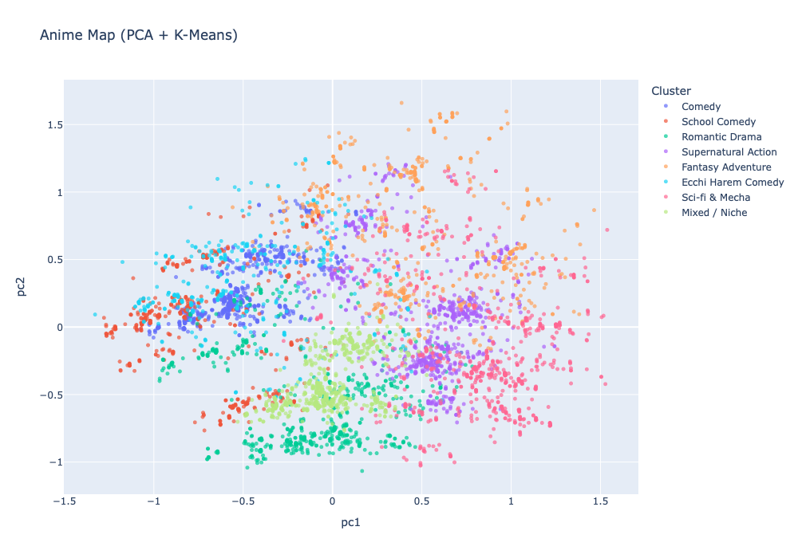

# Anime Map: PCA + K-Means

An interactive 2D map of ~6,600 anime from MyAnimeList. Each dot is one anime, and nearby dots share similar genres. Colors show clusters found by K-Means. IDK, I just bored and do this things.

Open `anime_map.html` in a browser to explore it: hover for details, click the legend to hide or show a cluster.

## How it works

1. Load the cleaned MyAnimeList data (pandas).
2. Turn each anime's genres into a multi-hot vector (one column per genre).
3. Add score and log-scaled episode count, all scaled to 0-1.
4. Cluster with K-Means in the full 45-dimensional space (k=8).
5. Project to 2D with PCA for plotting (about 21% of variance is kept).
6. Plot with Plotly.

Silhouette scores for k = 4 to 12 were all close (0.095 to 0.106), so k=8 was chosen for interpretable clusters.

## Notes

- Titles and genres of 18+ entries are masked on the map.
- Unrated anime (score 0) get the median score.

## Run it yourself

1. Download `anime_cleaned.csv` from the [MyAnimeList Dataset on Kaggle](https://www.kaggle.com/datasets/azathoth42/myanimelist) and put it in `data/raw/`.
2. Create a virtual environment and run `pip install -r requirements.txt`.
3. Open `notebooks/01_anime_map.ipynb` and run all cells.

## Tech

Python, pandas, scikit-learn, Plotly, Jupyter